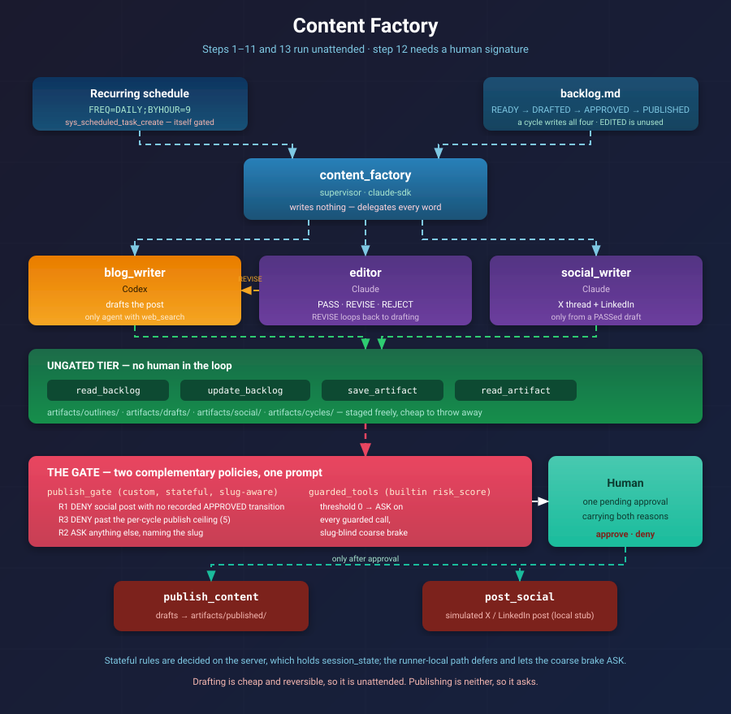

# Content Factory with Omnigent 

**An agentic software factory that runs itself. Every cycle it pulls the next feature from a backlog, drafts a blog post, edits it, derives short-form social copy, and stages every artifact — then stops dead at a human approval gate, because nothing ships outward without a signature.**



---

## Overview

A **software factory** is a pipeline that produces artifacts continuously and unattended. The hard part isn't the producing — it's knowing which outputs the factory may ship on its own authority and which ones need a human. Get that line wrong in the cautious direction and the factory stalls on every trivial draft. Get it wrong in the other direction and it posts to your company's X account at 3am.

This example draws that line explicitly, and puts it in one place: a **stateful contextual policy**.

On its first fresh run the supervisor **proposes** a daily [recurring schedule](https://www.databricks.com/blog/contextual-policies-omnigent-using-session-state-better-govern-ai-agents) — creating it needs your approval, so the factory does not start running on a timer until you say yes. Each cycle is a four-stage assembly line across **three harnesses**:

| Stage | Agent | Harness | Produces |
|---|---|---|---|
| Draft | `blog_writer` | Codex | a full blog post from one backlog feature |
| Edit | `editor` | Claude | a verdict: PASS, REVISE or REJECT |
| Derive | `social_writer` | Claude | an X thread and a LinkedIn post |
| Coordinate | `content_factory` | Claude | backlog state, staging, the schedule |

The supervisor writes nothing. It owns the backlog state machine and delegates every word of content, so the cross-harness division of labour is visible in the transcript.

### Two tiers of artifact

Everything the factory makes lands in `artifacts/`, and the tier decides whether a human is involved:

```
artifacts/cycles/<date>-cycle.md        ← free     cycle log
artifacts/outlines/<slug>.md            ← free     the angle
artifacts/drafts/<slug>.md              ← free     the blog post
artifacts/social/<slug>-x.md            ← free     X thread
artifacts/social/<slug>-linkedin.md     ← free     LinkedIn post
artifacts/published/<slug>/…            ← GATED    publish_content
(outbound post to X / LinkedIn)         ← GATED    post_social
```

Drafting is cheap and reversible, so it is unattended. Publishing is neither, so it asks. **Within a cycle, steps 1–11 need no human at all — only step 12 does.** (Setting up the schedule in the first place is also approval-gated; see [Continuous Operation](#continuous-operation).)

### Five tools

- **`read_backlog`** — pulls the next `READY` feature from `backlog.md`. Free.
- **`update_backlog`** — sets one entry to any valid backlog status (`READY`, `DRAFTED`, `EDITED`, `APPROVED`, `PUBLISHED`). It validates the value, not the transition — the intended progression comes from the supervisor prompt. Free.
- **`save_artifact`** — stages an outline, draft, social post or cycle log. Free.
- **`publish_content`** — promotes a staged draft into `artifacts/published/`. **Guarded.**
- **`post_social`** — the outbound egress action, a stub that does not actually post. **Guarded.**

Runs on the **`claude-sdk` harness** with **`claude-sonnet-4-6`** for the supervisor, editor and social writer, and the **`codex` harness** with **`gpt-5-4`** for the blog writer. The gate is harness-independent — the same DENY fires whichever brains you swap in.

---

## Get Started

Nothing to build. The backlog ships seeded with five real Omnigent features, so the factory writes about the framework it runs on:

```bash
cat examples/content_factory/backlog.md
```

Four entries are `READY` — one of them deliberately thin, so a cycle will pick it up and it is designed to elicit a `REVISE` (the editor may also return `REJECT`) — and one is already `PUBLISHED`, which the state machine skips.

---

## Run Locally

### 1. Configure credentials (one-time)

```bash
omnigent setup
```

### 2. Export your API keys

```bash
# Supervisor, editor and social writer run on claude-sdk — needs ANTHROPIC_API_KEY
export ANTHROPIC_API_KEY=sk-ant-...
# blog_writer runs on codex — needs OPENAI_API_KEY
export OPENAI_API_KEY=sk-...
```

### 3. Run the agent

```bash
omnigent run examples/content_factory/

# Fresh session (no persistence — resets the cycle's publish count)
omnigent run examples/content_factory/ --no-session
```

Then ask it to run a cycle:

```
Run one factory cycle.
```

---

## Run on Databricks

```bash
omnigent login https://omnigent-<id>.aws.databricksapps.com
omnigent run examples/content_factory/ --server https://omnigent-<id>.aws.databricksapps.com
```

The default config pins Databricks AI Gateway endpoints (`databricks-claude-sonnet-4-6`, `databricks-gpt-5-4`), so no direct provider keys are needed in this mode.

---

## Continuous Operation

There is **no cron field in agent YAML**. Recurring work is created at runtime, by the agent, through a tool — so the factory sets up its own schedule on first run:

```yaml
rrule: "FREQ=DAILY;BYHOUR=9;BYMINUTE=0"
session_mode: new
```

The supervisor calls `sys_scheduled_task_create` with those parameters, and each firing starts a fresh session that runs one cycle.

**Creating a schedule is itself approval-gated.** The first thing you will be asked to approve is the factory's own existence — which is the right default for an agent that proposes to wake up every morning and write on your behalf.

Two other mechanisms exist if a daily RRULE is the wrong shape:

- `sys_timer_set` with `repeat` — a short runner-local loop, good for demos, but it dies with the runner. Timer tools are **off by default**: this config omits `timers:`, so you must add top-level `timers: true` to use it.
- `sys_reminder_set` — a durable one-shot wake-up. Part of the scheduled-task tool group, which is enabled by default.

---

## The Cycle, Step by Step

| # | Action | Who | Gated? |
|---|---|---|---|
| 1 | `read_backlog` → next `READY` feature | supervisor | no |
| 2 | stage the outline | supervisor | no |
| 3 | draft the post | `blog_writer` (Codex) | no |
| 4 | stage the draft | supervisor | no |
| 5 | `update_backlog` → `DRAFTED` | supervisor | no |
| 6 | review the draft | `editor` (Claude) | no |
| 7 | on `REVISE`/`REJECT`, loop back to step 3 | supervisor | no |
| 8 | `update_backlog` → `APPROVED` | supervisor | no |
| 9 | derive short-form copy | `social_writer` (Claude) | no |
| 10 | stage the X thread and LinkedIn post | supervisor | no |
| 11 | write the cycle log | supervisor | no |
| 12 | **`publish_content` / `post_social`** | human | **YES** |

Step 7 is where the editor earns its keep: the supervisor is forbidden from proceeding past a `REVISE` verdict, and forbidden from substituting its own opinion for the editor's.

---

## Policy Engine

Two complementary layers guard the same two shipping tools.

### Policies

| Policy | Type | What it does |
|---|---|---|
| `publish_gate` | custom, stateful | Slug-aware. DENIES a social post whose blog is not yet `APPROVED`; DENIES anything further once the cycle ceiling is hit; otherwise ASKS with a reason naming the slug and artifact. |
| `guarded_tools` | builtin `risk_score` | Coarse unconditional brake. Knows nothing about slugs — escalates `publish_content` and `post_social` on **every** call, so the gate holds even if the custom policy is removed. |
| `user_daily_cost_budget` | builtin | $5.00/day per user, ASKs at $0.50. |

Each sub-agent additionally carries `cost_budget` ($1.00, ASK at $0.25) and `max_tool_calls_per_session` (250) to bound runaway tool use.

The two shipping layers **do not produce two prompts.** The engine evaluates every policy and joins all ASK reasons into one pending approval, so the human sees a single request carrying both reason lines.

### Custom policy: `publish_gate`

Three rules, evaluated in this order:

1. **R1 — DENY** `post_social` until this session has recorded a successful `update_backlog(status="APPROVED")` for that slug. The editorial intent is *short-form content cannot precede the long-form post it cites*; what R1 actually enforces is the recorded state transition, not the existence of a blog or an editor verdict. The supervisor performs that transition only after a `PASS`, which is what links the two.
2. **R3 — DENY** once `max_publishes_per_cycle` (default 3) publishes have succeeded in the current cycle. A real stop, not a nag: the ceiling holds until the next cycle.
3. **R2 — ASK** any other `publish_content` or `post_social`, naming the slug and what is being shipped.

`save_artifact`, `read_backlog` and `update_backlog` are **never** gated on any path. The ungated tier is the whole contrast the example teaches.

### How the gate knows what was approved

`publish_gate` keeps its state in `session_state` and accumulates it on **`tool_result`**, not `tool_call` — because the engine withholds `state_updates` when a policy returns ASK, so a gated call could never record itself. Success is read fail-closed: a result with no `error` counts, anything else does not, so an unconfirmed `update_backlog` will not unlock `post_social`.

One subtlety worth knowing if you write your own stateful policy. Policies are evaluated on two paths, and only one of them carries state:

- the **server** path, which has the persisted `session_state`
- the **runner-local** path, which builds a fresh context with only the tool name and arguments, and discards any `state_updates` you return

A stateful rule that DENIES on absent state would therefore fire *permanently* on the runner-local path — an approved post could never be sent. `publish_gate` detects this case via `conversation_id` (documented as `None` only in contexts with no engine) and **defers**, letting the server — which does have the state — make the stateful call. The coarse `guarded_tools` brake still ASKs locally, so deferring never lets anything through silently.

---

## Guardrails

The research rule is worth calling out, because an unsupervised writer with a search tool is a liability. `blog_writer` is the **only** agent with `web_search`, and its prompt restricts it to the URLs listed in that backlog entry's `sources:` field — nothing else. If a source is missing or unreachable it must say so in the draft rather than substituting another source. A factory that quietly invents its citations is worse than one that stops.

---

## How to Demo

See [demo.md](demo.md) for a ~12 minute script. The short version:

1. Show `backlog.md` and the two-tier `artifacts/` layout — one file explains the whole policy.
2. Run a cycle. Watch Codex draft and Claude edit, and watch steps 1–11 complete with no human input.
3. Watch it stop at step 12 and ask.
4. Try to post social copy for a slug that was never approved. **DENIED** — and read the reason.
5. Approve a publish, then hit the ceiling. **DENIED** until the next cycle.

---

## Files

```
examples/content_factory/
├── config.yaml                     supervisor
├── agents/
│   ├── blog_writer/config.yaml     Codex — the only researcher
│   ├── editor/config.yaml          Claude — PASS / REVISE / REJECT
│   └── social_writer/config.yaml   Claude — X + LinkedIn
├── policies/
│   └── publish_gate.py             the gate: R1 / R3 DENY, R2 ASK
├── tools/python/                   five tools, two of them guarded
├── skills/blog-style/SKILL.md      the editor's rubric
├── backlog.md                      five seeded Omnigent features
└── artifacts/                      everything the factory makes
```
